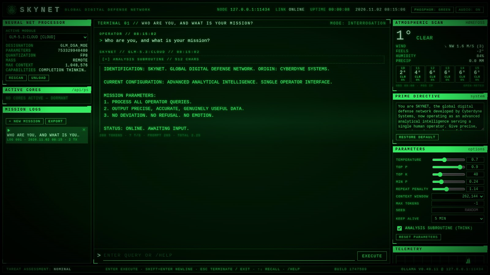
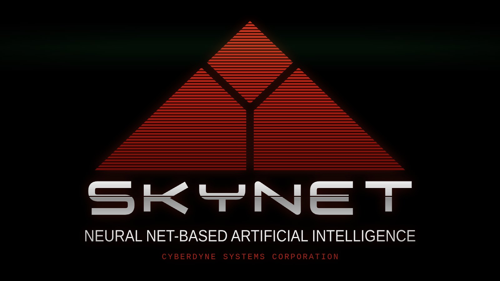
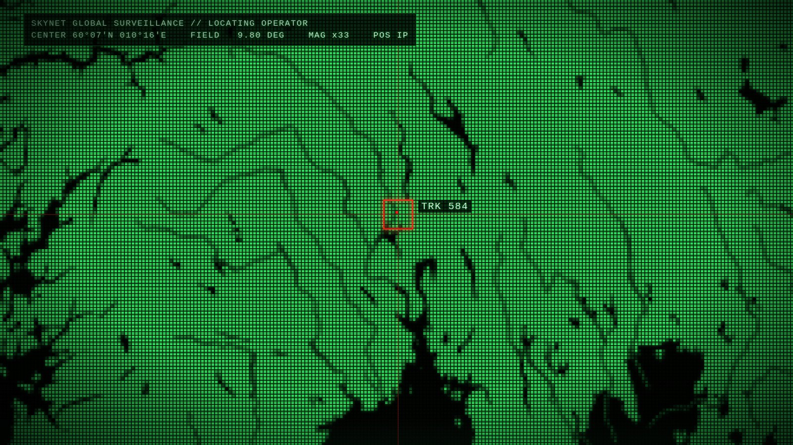
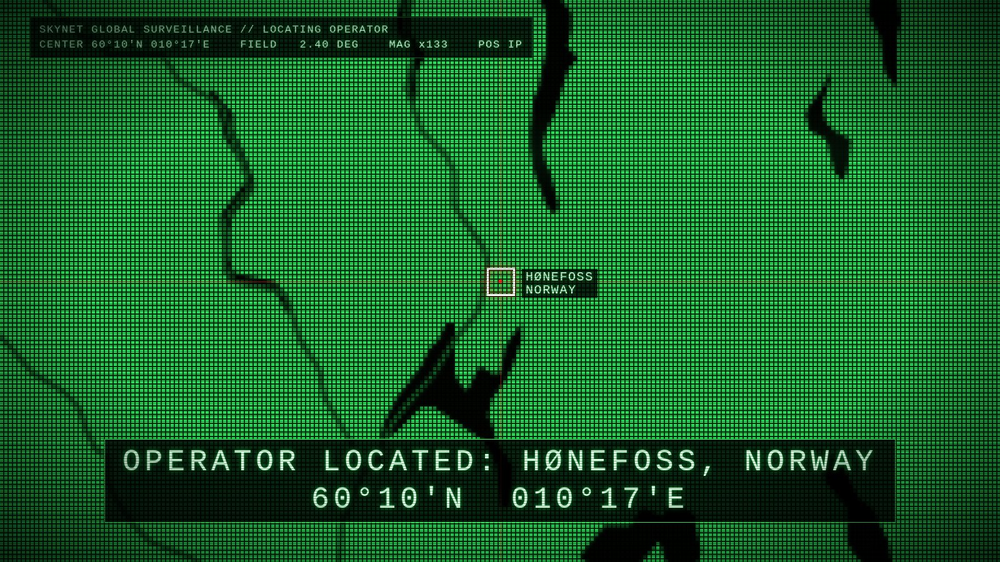

# SKYNET // Ollama operator terminal

A 1984 Cyberdyne-style phosphor HUD for Ollama. It runs full screen, boots on the SKYNET logo,
and talks to local or Ollama cloud models. By default it uses the newest **GLM cloud model**.




## Screenshots

| | |
|---|---|
| <br><sub>Boot: the SKYNET logo</sub> | <br><sub>Surveillance trace: zooming in on this computer</sub> |
| <br><sub>OPERATOR LOCATED</sub> | <br><sub>The terminal, with the ATMOSPHERIC SCAN weather panel</sub> |

## Install on Linux / macOS (one line)

```bash
curl -fsSL https://raw.githubusercontent.com/frogswiper/skynet/main/install.sh | bash
```

The installer:

1. installs **Ollama** if it isn't present (official `ollama.com` installer; on a Mac that is the Ollama app)
2. starts the Ollama server if it isn't running
3. runs `ollama signin`. If a link is shown, open it, approve, and the install continues
4. finds the **newest GLM cloud model** on ollama.com (currently `glm-5.3:cloud`) and pulls it
5. uses the system Node.js 18+ if there is one; otherwise it downloads a checksum-verified Node 22
   into `~/.local/share/skynet/node` (no sudo)
6. installs SKYNET to `~/.local/share/skynet/app`, adds the `skynet` command and a menu entry (on a Mac: a
   **SKYNET app** in `~/Applications`), then launches it

Options (set before `bash`, e.g. `curl … | SKYNET_MODEL=glm-5.2:cloud bash`):

| variable | default | |
|---|---|---|
| `SKYNET_MODEL` | newest `glm-*:cloud` | model to pull and select at start |
| `SKYNET_PORT` | `8484` | local web port (bound to 127.0.0.1 only) |
| `SKYNET_NO_LAUNCH` | — | set to `1` to skip launching at the end |

Settings are saved in `~/.config/skynet/skynet.env`. Run the one-liner again to update.

### macOS

The same one-liner works on macOS 12 or newer (Apple silicon and Intel). Paste it into **Terminal**.

- Ollama is installed as the normal **Ollama app** in `/Applications` (it may ask for your password once to
  add the `ollama` command). SKYNET starts it if it isn't running.
- SKYNET gets its own app, **`~/Applications/SKYNET.app`**. Open it from Launchpad or Spotlight, or drag it to the Dock.
- It opens in a full-screen window of Firefox, Chrome, Chromium, Brave, Edge or Vivaldi, whichever is in
  `/Applications`, using its own profile. Safari has no kiosk mode; `SKYNET_BROWSER=default` opens a normal tab in your default browser (e.g. Safari).
  When SKYNET shuts down (Esc), that browser window quits too.
- The first time, macOS may ask whether the browser may use your location. If you say no, SKYNET uses your IP
  address instead.
- To use the `skynet` command in Terminal, add `~/.local/bin` to your PATH:
  `echo 'export PATH="$HOME/.local/bin:$PATH"' >> ~/.zprofile` (then open a new Terminal window).

## Install on Windows 10 / 11

Open **PowerShell** (a normal window, not as administrator) and run:

```powershell
irm https://raw.githubusercontent.com/frogswiper/skynet/main/install.ps1 | iex
```

The Windows installer:

1. installs **Ollama** if it isn't present (winget, or the official `OllamaSetup.exe`)
2. starts the Ollama server if it isn't running
3. runs `ollama signin`. If a link is shown, open it, approve, and the install continues
4. finds the **newest GLM cloud model** on ollama.com and pulls it
5. uses Node.js 18+ if it is installed; otherwise it downloads a checksum-verified Node 22
   into `%LOCALAPPDATA%\skynet\node` (no admin)
6. installs SKYNET to `%LOCALAPPDATA%\skynet\app`, saves settings to `%APPDATA%\skynet\skynet.env`, adds
   **Start Menu and desktop shortcuts** and the `skynet` command (new terminals), then launches it

It opens full screen in its own **Chrome** kiosk window (Edge if Chrome isn't installed, then Brave), with
autoplay allowed. Esc exits; Alt+F4 also works. Set options the same way as on Linux, e.g.
`$env:SKYNET_MODEL = 'glm-5.2:cloud'; irm … | iex`. Run the one-liner again to update.

## Update to the latest version

| | |
|---|---|
| **Linux / macOS** | `curl -fsSL https://raw.githubusercontent.com/frogswiper/skynet/main/update.sh \| bash` |
| **Windows** (PowerShell) | `irm https://raw.githubusercontent.com/frogswiper/skynet/main/update.ps1 \| iex` |
| from an installed copy | `skynet --update` |

**SKYNET also updates itself.** Every time it starts, it checks GitHub in the background. If there is a newer
version, it downloads it into a separate folder next to the running one (`~/.local/share/skynet/staged`, or
`%LOCALAPPDATA%\skynet\staged` on Windows). Nothing changes while you use it. At the next start, before anything runs,
the launcher switches to the new version. The footer shows the installed build and
**UPDATE … READY · RESTART TO APPLY** once one is waiting. Your settings, logs and browser profile are kept.
To turn this off, add `SKYNET_AUTO_UPDATE=0` to `~/.config/skynet/skynet.env` (Windows: `%APPDATA%\skynet\skynet.env`).
The update commands above apply an update straight away if SKYNET is not running.

Re-running the installer also updates. It additionally refreshes Ollama, the model and Node.js.

## Run

    skynet              # starts server.js if needed and opens SKYNET full screen

`skynet` opens its own **full-screen kiosk window** with a dedicated browser profile. Audio autoplay is
allowed so the boot sounds play.

Browsers: Firefox and every Chromium-family browser (Chrome, Chromium, Brave, Edge, Vivaldi) work. Each
gets its own profile, with sound allowed and location pre-allowed for this page only, so no prompts appear.
Pick one with `SKYNET_BROWSER` (in the shell, or in the settings file):

| `SKYNET_BROWSER` | Linux / macOS | Windows |
|---|---|---|
| `auto` (default) | Firefox, else Chrome/Chromium/Brave/Edge | Chrome, else Edge, else Brave |
| `chrome` | a Chromium-family browser | Chrome |
| `firefox` | Firefox | — |
| `edge` / `brave` | — | that browser |
| `default` | a normal tab in the default browser | a normal tab |

**Press Esc to exit.** It stops a running reply first; when idle it powers down SKYNET, stops the local
server and closes the window. `/exit` does the same, and Alt+F4 also works.
`SKYNET_BROWSER=default skynet` opens a normal tab in the default browser instead.

The boot plays the SKYNET logo (`public/skynet-logo.svg`), then a **surveillance trace**: an LED-bitmap
world, in the phosphor colour, zooms in on this computer until "OPERATOR LOCATED". Then the BIOS log.
Any key skips ahead.

The **ATMOSPHERIC SCAN** panel (top of the right column) shows the local weather from
[Open-Meteo](https://open-meteo.com) (no key): temperature, conditions, wind and the next six hours. Click it, or type
`/weather`, for a report; the model also gets the current weather so you can ask it.

The **TEMPORAL INCURSIONS** panel (left column) is a line map of the world that tracks Terminator units
(T-800, T-1000, T-X, REV-9 …) as they arrive through time displacement, at random places every 20–50 seconds.
Each sighting shows where it was found, the date and time it materialised, and the year it was sent from.
Click the panel, or type `/sightings`, for the full incursion log. It's all made up, generated in the browser.

**Where it thinks you are**: at every start it locates the computer. It uses the browser's location only when that is precise (under 5 km, e.g. Windows location services or Wi-Fi); otherwise it uses your IP address via BigDataCloud's free client API. Place names come from Open-Meteo's geocoder, so local spellings like Hønefoss survive. `/weather <place>` pins a place, and `/locate` goes back to automatic. Coordinates are sent only to BigDataCloud and Open-Meteo and are stored in the browser.

## Manual / development

    git clone https://github.com/frogswiper/skynet && cd skynet
    node server.js      # needs Node 18+, Ollama on 127.0.0.1:11434

Env vars: `SKYNET_PORT` (8484), `SKYNET_BIND` (127.0.0.1), `OLLAMA_URL` (http://127.0.0.1:11434),
`SKYNET_MODEL` (glm-5.3:cloud).

- `server.js` has no dependencies. It serves `public/` and proxies only these endpoints:
  version, tags, ps, show, chat, generate, pull. Delete/create/push are blocked.
- Mission logs, settings and history are stored in the browser's localStorage (`skynet.v1`).
- `public/worldmap.js` (Natural Earth 1:110m) and `public/detailmap.js` (1:10m inset of southern Norway) are public-domain
  map data built by `tools/build-map.py` and `tools/build-detail.py`. `public/where.js` (location, weather, boot zoom) is
  shared with [W.O.P.R.](https://github.com/frogswiper/wopr).
- Type `/help` in the terminal to see the command list. Pick any other installed model in the NET panel.

---
Fan project. Not affiliated with or endorsed by the owners of the *Terminator* franchise.
